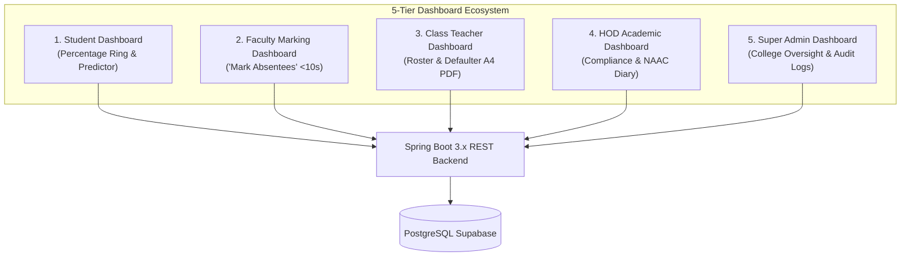

# OpenAttend — Complete Dashboard Ecosystem Specification

> **Document Type:** System Dashboard Architecture & Specification  
> **Target Platform:** OpenAttend — Native Attendance ERP System (VESIT)  
> **Version:** 2.0 (Native Multi-Role Architecture)  
> **UI Stack:** Modern Responsive Frontend (v0.dev / React + Tailwind CSS / shadcn/ui or Native PWA)  
> **Backend Integration:** Spring Boot 3.x REST APIs + PostgreSQL (Supabase)  

---

## Executive Overview & Role-Based Dashboard Matrix

OpenAttend organizes its entire user experience around **5 dedicated, role-specific dashboards**. Each dashboard is tailored to the exact workflow of that stakeholder:

| # | Dashboard Name | Primary User | Primary Goal | Key Interaction / Metric | Core SLA |
|---|---|---|---|---|---|
| **1** | **Student Attendance & 75% Predictor** | `STUDENT` | Daily attendance clarity & threshold safety | Big circular percentage ring, Safe Skips / Must-Attend recovery counter | < 2s to know status |
| **2** | **Faculty High-Speed Classroom Marking** | `FACULTY` | Frictionless lecture marking & NAAC logging | High-speed "Mark Absentees" chip grid (< 10s classroom marking) | < 10s per lecture |
| **3** | **Class Teacher Division & Defaulter ERP** | `CLASS_TEACHER` | Division roster management & defaulter notices | 1-Click Printable A4 Defaulter Notice PDF & OD leave approvals | 1-Click generation |
| **4** | **HOD & Department Academic Oversight** | `ADMIN` (HOD) | Academic compliance & faculty syllabus tracking | Division comparison matrix & NAAC Course Diary compilation | Real-time audit |
| **5** | **Super Admin Institutional & Audit ERP** | `SUPER_ADMIN` | College-wide governance, calendar & security | Immutable attendance audit log & semester configuration | Full institutional audit |



---

## Dashboard 1: Student Attendance & 75% Predictor Dashboard

### 1.1 Persona & Core Objective
- **Target User:** Enrolled Undergraduate & Postgraduate Students (`STUDENT`).
- **Core Value:** Instantly answer *"Am I above 75%?"* within two seconds on mobile, plan upcoming leaves with a mathematical **Safe Skips** calculator, and track date-by-date attendance without asking teachers.

### 1.2 Layout & Visual Wireframe
```text
┌──────────────────────────────────────────────────────────────────────────────┐
│ [Logo] OpenAttend       Student: Aryan Sharma (Roll 24, D15B)    [Bell] [🌙/☀️]│
├──────────────────────────────────────────────────────────────────────────────┤
│ ┌──────────────────────────────────────┐  ┌─────────────────────────────────┐│
│ │         OVERALL ATTENDANCE           │  │      PREDICTOR ACTION BANNER    ││
│ │              ╭──────╮                │  │  🎉 SAFE ZONE (78.4% ≥ 75%)     ││
│ │            ╭─╯ 78.4%╰─╮              │  │                                 ││
│ │            │   SAFE   │              │  │  You can safely SKIP:           ││
│ │            ╰─╮      ╭─╯              │  │  ▶ 3 More Lectures              ││
│ │              ╰──────╯                │  │  before dropping below 75%.     ││
│ │   Total: 142  |  Attended: 111       │  │                                 ││
│ └──────────────────────────────────────┘  └─────────────────────────────────┘│
├──────────────────────────────────────────────────────────────────────────────┤
│ ┌──────────────────────────────────────────────────────────────────────────┐│
│ │ SUBJECT-WISE BREAKDOWN                                                   ││
│ │ [OS]   Operating Systems     84.0% [=====>      ] 21/25  [Simulate Skip] ││
│ │ [DBMS] Database Systems      76.5% [====>       ] 26/34  [Simulate Skip] ││
│ │ [CN]   Computer Networks     68.2% [===>        ] 15/22  ⚠️ Must attend 4 ││
│ │ [SE]   Software Engineering  82.0% [=====>      ] 27/33  [Simulate Skip] ││
│ └──────────────────────────────────────────────────────────────────────────┘│
├──────────────────────────────────────────────────────────────────────────────┤
│ ┌──────────────────────────────────────┐  ┌─────────────────────────────────┐│
│ │ TODAY'S LECTURE TIMETABLE            │  │ QUICK ACTION PORTAL             ││
│ │ 09:00 - OS (Theory)   [✅ Attended]   │  │ [📝 Apply for OD / Medical Leave││
│ │ 10:00 - CN (Theory)   [❌ Absent]     │  │ [📜 Export Attendance CSV]      ││
│ │ 11:15 - DBMS Lab (B2) [⏳ Upcoming]   │  │ [📊 Weekly Attendance Trajectory││
│ └──────────────────────────────────────┘  └─────────────────────────────────┘│
└──────────────────────────────────────────────────────────────────────────────┘
```

### 1.3 Key Component Widgets
1. **Attendance Status Hero Ring:**
   - Circular SVG/Canvas gauge animated on load.
   - Dynamic theme colors: Green (`≥ 75%`), Amber (`65% – 74.9%`), Crimson (`< 65%`).
2. **Mathematical Predictor Card:**
   - Displays real-time calculations based on PRD formulas:
     - **Safe Skips ($P \ge 75\%$):** $S = \lfloor \frac{4A - 3T}{3} \rfloor$
     - **Must Attend ($P < 75\%$):** $R = \lceil 3T - 4A \rceil$
3. **Subject Breakdown Cards with What-If Simulator:**
   - Shows attended vs conducted per subject.
   - Interactive "Simulate Miss / Attend" toggle allowing students to preview the impact of attending or skipping next week's lectures.
4. **Today's Class Timetable:**
   - Real-time status cards for each lecture slot (`ATTENDED`, `ABSENT`, `DUTY_PRESENT`, `UPCOMING`).
5. **Digital OD / Medical Leave Modal:**
   - Submits leave requests with date range, reason, and event/medical proof upload.

### 1.4 API Contract
- `GET /api/v1/attendance/student/me`
- `GET /api/v1/predictor/calculate?attended={A}&total={T}`
- `POST /api/v1/student/od-leaves/apply`

---

## Dashboard 2: Faculty High-Speed Classroom Marking & Lecture Diary

### 2.1 Persona & Core Objective
- **Target User:** Subject Teachers, Lab Instructors, and Guest Faculty (`FACULTY`).
- **Core Value:** Record classroom attendance for 70+ students in **under 10 seconds** without roll calls by tapping only the 3–5 absentees, while logging lecture topics for NAAC/NBA compliance.

### 2.2 Layout & Visual Wireframe
```text
┌──────────────────────────────────────────────────────────────────────────────┐
│ [Logo] OpenAttend       Faculty: Prof. Anita Patil (CMPN)         [48h Active]│
├──────────────────────────────────────────────────────────────────────────────┤
│ Class: [ D15B - Operating Systems ▼ ]  Date: [ 2026-09-10 ]  Slot: [ Slot 2 ]│
│ Batch: [ ALL (Division) ] [ Batch A ] [ Batch B ] [ Batch C ]                │
├──────────────────────────────────────────────────────────────────────────────┤
│ ┌──────────────────────────────────────────────────────────────────────────┐│
│ │ LIVE COUNTER:  Total: 72  |  Present: 69  |  Absent: 3  |  Roll: 03, 14, 52││
│ └──────────────────────────────────────────────────────────────────────────┘│
├──────────────────────────────────────────────────────────────────────────────┤
│ HIGH-SPEED ABSENTEES CHIP GRID (<10s TAP TO MARK ABSENT):                    │
│ ┌───────────────┐ ┌───────────────┐ ┌───────────────┐ ┌───────────────┐      │
│ │[01] M. Ahuja  │ │[02] K. Amarnani│ │[03] J. Arora ✕│ │[04] S. Awasthi│      │
│ │  (Present)    │ │  (Present)    │ │  (ABSENT 🔴)  │ │  (Present)    │      │
│ └───────────────┘ └───────────────┘ └───────────────┘ └───────────────┘      │
│ ┌───────────────┐ ┌───────────────┐ ┌───────────────┐ ┌───────────────┐      │
│ │[05] U. Bhangale││[06] S. Chhatlan││[07] K. Devadiga││[08] A. Dubey   │      │
│ └───────────────┘ └───────────────┘ └───────────────┘ └───────────────┘      │
├──────────────────────────────────────────────────────────────────────────────┤
│ NAAC Academic Diary: Topic Covered: [ Process Synchronization & Semaphores  ]│
│ Lecture Type: (•) Theory   ( ) Lab Practical   ( ) Remedial / Tutorial       │
├──────────────────────────────────────────────────────────────────────────────┤
│ [ Mark All Present ]    [ Invert Selection ]       [ SUBMIT ATTENDANCE (3) ] │
└──────────────────────────────────────────────────────────────────────────────┘
```

### 2.3 Key Component Widgets
1. **Context Selector Bar:**
   - Dropdown selects designated classes from `GET /api/v1/faculty/my-subjects`.
   - Division / Lab Batch tabs (`ALL`, `Batch A`, `Batch B`, `Batch C`).
2. **Absentees Chip Grid:**
   - Tactile student chips showing `[Roll No] [Student Name]`.
   - Default State: Pine Green outline (**Present**).
   - Tap Interaction: Instantly toggles to Crimson Red background with ✕ (**Absent**).
3. **Real-Time Absentees Summary Banner:**
   - Shows live counts: `Total: 72 | Present: 69 | Absent: 3 (Roll: 03, 14, 52)`.
4. **NAAC Course Diary Input:**
   - Text input for "Topic Covered" and radio buttons for lecture type.
5. **48-Hour Session Correction Tab:**
   - Lists recent sessions within the 48-hour window.
   - Allows faculty to edit marking mistakes with a mandatory text justification.
6. **Proxy Lecture Assignment Modal:**
   - Delegate a class to a substitute faculty member when on leave.

### 2.4 API Contract
- `GET /api/v1/faculty/my-subjects`
- `POST /api/v1/faculty/attendance/submit`
- `PUT /api/v1/faculty/attendance/{sessionId}/correct`
- `POST /api/v1/faculty/proxy/assign`

---

## Dashboard 3: Class Teacher Division & Defaulter ERP Dashboard

### 3.1 Persona & Core Objective
- **Target User:** Class Teachers & Year Division In-Charges (`CLASS_TEACHER`).
- **Core Value:** Manage semester student rosters, monitor division-wide attendance trajectories, approve OD/medical leaves, and generate the official **Printable A4 Defaulter Notice PDF** with a single click.

### 3.2 Layout & Visual Wireframe
```text
┌──────────────────────────────────────────────────────────────────────────────┐
│ [Logo] OpenAttend       Division In-Charge: Prof. R. Kulkarni (D15B)        │
├──────────────────────────────────────────────────────────────────────────────┤
│ DIVISION KPI SUMMARY (D15B - SEMESTER VI):                                   │
│ ┌──────────────────┐ ┌──────────────────┐ ┌──────────────────┐ ┌────────────┐│
│ │ DIVISION AVERAGE │ │ CRITICAL (<65%)  │ │ WARNING (65-75%) │ │ LECTURES   ││
│ │      76.8%       │ │   4 Students 🔴  │ │   8 Students 🟡  │ │ 184 Total  ││
│ └──────────────────┘ └──────────────────┘ └──────────────────┘ └────────────┘│
├──────────────────────────────────────────────────────────────────────────────┤
│ 1-CLICK DEFAULTER MANAGEMENT & REPORTING:                                    │
│ Filter: [ ALL ] [ < 65% Critical ] [ 65%-75% Warning ] [ Search Student... ]│
│ [ 📄 GENERATE OFFICIAL A4 PDF DEFAULTER NOTICE ]   [ 📱 SEND WHATSAPP/SMS ] │
├──────────────────────────────────────────────────────────────────────────────┤
│ ROSTER TABLE:                                                                │
│ Roll  Student Name       OS    DBMS   CN    SE    Total %   Parent Phone     │
│ ──────────────────────────────────────────────────────────────────────────── │
│ 03    J. Arora           58%   62%    55%   60%   58.7% 🔴  +91 98201xxxxx   │
│ 08    A. Dubey           70%   68%    74%   71%   70.8% 🟡  +91 98202xxxxx   │
│ 14    R. Iyer            88%   91%    85%   89%   88.2% 🟢  +91 98203xxxxx   │
├──────────────────────────────────────────────────────────────────────────────┤
│ ┌──────────────────────────────────────┐  ┌─────────────────────────────────┐│
│ │ MASTER SEMESTER ROSTER UPLOAD        │  │ DIGITAL OD LEAVE APPROVALS      ││
│ │ [ 📂 Drag & Drop Master Excel (.xlsx)│  │ [Aryan Sharma - Hackathon - 2d] ││
│ │ Auto-parses: Roll, Name, Batch, Elec │  │ [Approve ✅]       [Reject ❌]   ││
│ └──────────────────────────────────────┘  └─────────────────────────────────┘│
└──────────────────────────────────────────────────────────────────────────────┘
```

### 3.3 Key Component Widgets
1. **Division Health Overview Cards:**
   - Average division percentage, Critical count, Warning count, and Today's submission status.
2. **1-Click Official A4 PDF Defaulter Generator:**
   - Generates the formal institution-formatted A4 notice with:
     - Official VESIT letterhead & department name.
     - Student table grouped into Critical (`<65%`) and Warning (`65%–74.9%`).
     - Formal signature blocks for Class Teacher, Attendance In-Charge, and HOD.
3. **Master Division Excel (.xlsx) Upload Zone:**
   - Start-of-semester drag-and-drop roster importer with automatic Apache POI parsing.
   - Live column mapping validator (Roll No, Full Name, Email, Lab Batch, Electives).
4. **Digital OD / Medical Leave Approvals Inbox:**
   - Pending leave applications with attachment viewer and 1-click Approve/Reject.
5. **Emergency 48-Hour Unlock Action:**
   - Class teacher authority to unlock a past-48-hour lecture session for faculty edits.

### 3.4 API Contract
- `POST /api/v1/admin/roster/upload`
- `GET /api/v1/admin/defaulters?division=D15B`
- `GET /api/v1/admin/defaulters/export-pdf?division=D15B`
- `PUT /api/v1/admin/od-leaves/{leaveId}/review`

---

## Dashboard 4: HOD & Department Academic Oversight Dashboard

### 4.1 Persona & Core Objective
- **Target User:** Head of Department (HOD) & Academic Coordinators (`ADMIN`).
- **Core Value:** Cross-division academic governance, faculty teaching compliance, syllabus pacing tracking, and 1-click **NAAC/NBA Course Diary** compilation.

### 4.2 Layout & Visual Wireframe
```text
┌──────────────────────────────────────────────────────────────────────────────┐
│ [Logo] OpenAttend       HOD Dashboard: Computer Engineering Department      │
├──────────────────────────────────────────────────────────────────────────────┤
│ DEPARTMENT SNAPSHOT (CMPN - 6 DIVISIONS, 440 STUDENTS):                      │
│ ┌──────────────────┐ ┌──────────────────┐ ┌──────────────────┐ ┌────────────┐│
│ │ OVERALL CMPN ATT │ │ TOTAL DEFAULTERS │ │ FACULTY MARKING  │ │ NAAC LOGS  ││
│ │      78.1%       │ │   28 (< 75%)     │ │  96.4% On-Time   │ │ 1,240 Skt  ││
│ └──────────────────┘ └──────────────────┘ └──────────────────┘ └────────────┘│
├──────────────────────────────────────────────────────────────────────────────┤
│ DIVISION COMPARATIVE BENCHMARK:                                              │
│ Division   Semester   Avg Att %    Critical (<65%)   Warning (65-75%) Status │
│ D7A        Sem IV     81.2%        2                 5                🟢 Good│
│ D7B        Sem IV     77.4%        4                 7                🟢 Good│
│ D12A       Sem VI     74.1%        6                 11               🟡 Warn│
│ D15B       Sem VI     76.8%        4                 8                🟢 Good│
├──────────────────────────────────────────────────────────────────────────────┤
│ ┌──────────────────────────────────────┐  ┌─────────────────────────────────┐│
│ │ FACULTY TEACHING & SYLLABUS PACING   │  │ NAAC / NBA ACCREDITATION EXPORT ││
│ │ Prof. A. Patil  - OS   (24/30 lecs)  │  │ [ 📥 Download Complete NAAC     ││
│ │ Prof. K. Rao    - DBMS (28/30 lecs)  │  │   Academic Course File (ZIP)    ││
│ │ Prof. S. Mehta  - CN   (19/30 lecs) ⚠️│  │   Includes: Topics, Dates, %]   ││
│ └──────────────────────────────────────┘  └─────────────────────────────────┘│
├──────────────────────────────────────────────────────────────────────────────┤
│ FACULTY SUBJECT & LAB BATCH ALLOCATION MATRIX:                               │
│ [ Allocate New Faculty ] [ View Department Timetable ] [ Proxy Audit Log ]   │
└──────────────────────────────────────────────────────────────────────────────┘
```

### 4.3 Key Component Widgets
1. **Department Health Matrix:**
   - Multi-division comparative bar chart (Comparing Sem III vs Sem V vs Sem VII).
2. **Faculty Teaching Compliance Monitor:**
   - Highlights teachers who haven't marked attendance within 24 hours of lecture completion.
   - Pacing tracker: Scheduled lectures vs conducted lectures.
3. **NAAC / NBA Course Diary Compiler:**
   - Generates comprehensive course file exports including lecture dates, syllabus topics covered, and student performance metrics.
4. **Faculty Subject & Lab Batch Allocation Manager:**
   - Drag-and-drop or modal assigner linking faculty members to divisions and practical batches.

### 4.4 API Contract
- `GET /api/v1/hod/analytics/department-overview`
- `GET /api/v1/hod/faculty-compliance`
- `POST /api/v1/admin/allocations`
- `GET /api/v1/faculty/diary/export-naac`

---

## Dashboard 5: Super Admin Institutional & Security Audit Dashboard

### 5.1 Persona & Core Objective
- **Target User:** Principal, Vice-Principal & ERP Technical Administrators (`SUPER_ADMIN`).
- **Core Value:** Centralized college-wide configuration, institutional calendar management, role-based user directory administration, and immutable security audit logs.

### 5.2 Layout & Visual Wireframe
```text
┌──────────────────────────────────────────────────────────────────────────────┐
│ [Logo] OpenAttend       Institutional ERP Governance Console   [Super Admin] │
├──────────────────────────────────────────────────────────────────────────────┤
│ INSTITUTIONAL OVERVIEW (VESIT - ALL DEPARTMENTS):                            │
│ Total Students: 2,410 | Faculty: 142 | Daily Lectures: 320 | Active Terms: 2 │
├──────────────────────────────────────────────────────────────────────────────┤
│ ┌──────────────────────────────────────────────────────────────────────────┐│
│ │ IMMUTABLE SECURITY & ATTENDANCE AUDIT LOG                                ││
│ │ Timestamp        User               Action               Details         ││
│ │ 10:14:02 Today   Prof. A. Patil     48h Correction       Roll 03 -> Pres ││
│ │                                                          "Student in Lab"││
│ │ 09:30:15 Today   Prof. R. Kulkarni  Roster Upload        D15B (72 stud)  ││
│ │ 08:45:00 Today   Admin User         Role Elevation       Assign HOD CMPN ││
│ └──────────────────────────────────────────────────────────────────────────┘│
├──────────────────────────────────────────────────────────────────────────────┤
│ ┌──────────────────────────────────────┐  ┌─────────────────────────────────┐│
│ │ ACADEMIC TERM & CALENDAR CONFIG      │  │ SYSTEM HEALTH & INFRASTRUCTURE  ││
│ │ Active Term: Odd Semester 2026-27    │  │ PostgreSQL Supabase: 🟢 12ms    ││
│ │ Start Date: 2026-07-15 | End: 11-30  │  │ Spring Boot API:    🟢 99.98%  ││
│ │ Defaulter Cutoff 1: 2026-09-15       │  │ PWA Cache Sync:     🟢 Online   ││
│ └──────────────────────────────────────┘  └─────────────────────────────────┘│
└──────────────────────────────────────────────────────────────────────────────┘
```

### 5.3 Key Component Widgets
1. **Institutional Analytics Bar:**
   - College-wide attendance rate across all engineering streams (CMPN, IT, EXTC, ETRX, AI&DS).
2. **Immutable Audit Trail:**
   - Security record capturing every edit, justification, proxy assignment, and roster change with user email and IP address.
3. **Academic Term & Calendar Manager:**
   - Configure semester start/end dates, national holidays, Unit Test dates, and mandatory defaulter cutoff milestones.
4. **User & RBAC Manager:**
   - Assign roles (`FACULTY`, `CLASS_TEACHER`, `ADMIN`, `SUPER_ADMIN`).
   - Enforces strict `@ves.ac.in` domain restrictions.
5. **System Diagnostics & Performance Monitor:**
   - Latency metrics, query execution speed, and cache status.

### 5.4 API Contract
- `GET /api/v1/superadmin/audit-logs`
- `POST /api/v1/superadmin/academic-terms/configure`
- `PUT /api/v1/superadmin/users/{userId}/roles`
- `GET /actuator/health`

---

## Design System & Cross-Dashboard Tokens

All 5 dashboards share a unified, high-contrast, calm aesthetic:

### Color Palette Tokens
```css
/* Core Institutional Brand */
--accent:         #2F6F5E;   /* OpenAttend Forest Pine */
--accent-dim:     #E4EFEB;   /* Subtle Pine Tint */
--accent-dark:    #5FBFA6;   /* Dark Mode Pine Glow */

/* Semantic Attendance States */
--state-safe:     #2F9E6E;   /* ≥ 75%, Present (Emerald) */
--state-warn:     #C98A1E;   /* 65% – 74.9%, Warning Zone (Amber) */
--state-risk:     #D64545;   /* < 65%, Absent, Defaulter (Crimson) */
--state-neutral:  #8B897F;   /* No lecture, Pending (Slate) */

/* Surfaces (Light / Dark) */
--bg-light:       #FAFAF8;   /* Notebook white */
--surface-light:  #FFFFFF;
--bg-dark:        #14161A;   /* Night study theme */
--surface-dark:   #1B1E23;
```

---

## Implementation Roadmap for v0.dev & Antigravity

```
┌─────────────────────────────────────────────────────────────────────────────┐
│ STEP 1: UI Generation in v0.dev                                             │
│ Select dashboard prompt from docs/dashboard.md ──> Paste in v0.dev          │
└──────────────────────────────────────┬──────────────────────────────────────┘
                                       │
┌──────────────────────────────────────▼──────────────────────────────────────┐
│ STEP 2: Import into Workspace                                               │
│ Copy JSX / Run `npx v0 add <id>` ──> Place in frontend/src/components/      │
└──────────────────────────────────────┬──────────────────────────────────────┘
                                       │
┌──────────────────────────────────────▼──────────────────────────────────────┐
│ STEP 3: Antigravity Backend Wiring                                          │
│ Antigravity replaces dummy props with Spring Boot REST API calls + JWT      │
│ Database persistence guaranteed via PostgreSQL Supabase                     │
└─────────────────────────────────────────────────────────────────────────────┘
```
